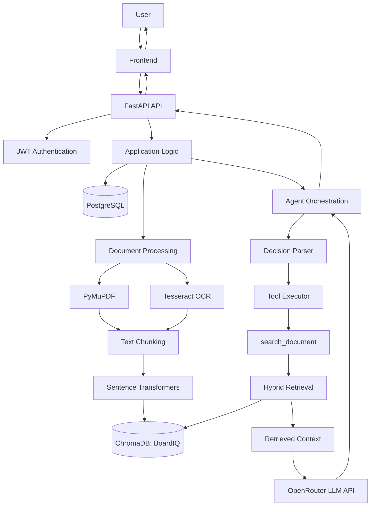

# DocLenseAI

**An AI-powered document intelligence platform for querying documents using semantic search, Retrieval-Augmented Generation (RAG), and an agent-based architecture.**

DocLenseAI is a document intelligence application designed to help users interact with their documents through natural-language questions instead of manually searching through lengthy files.

The project combines document extraction, OCR, semantic embeddings, vector search, hybrid retrieval, large language models (LLMs), and an agent tool-execution loop to build a system that can retrieve relevant information from uploaded documents and use that information to generate context-aware answers.

The primary engineering goal is to build a system in which an LLM does not have to rely entirely on its pretrained knowledge. Instead, the application retrieves relevant information from a user's own documents and supplies that information as context for answering questions.

> **Project status:** Active development. The backend incorporates document processing, retrieval, RAG, authentication, database management, and agent orchestration. Frontend integration and individual feature completion should be verified against the current repository before release.

---

## Table of Contents

- [Overview](#overview)
- [Problem Statement](#problem-statement)
- [Project Goals](#project-goals)
- [Core Features](#core-features)
- [Technology Stack](#technology-stack)
- [System Architecture](#system-architecture)
- [How the Application Works](#how-the-application-works)
- [Document Processing Pipeline](#document-processing-pipeline)
- [Embeddings and Semantic Search](#embeddings-and-semantic-search)
- [Retrieval-Augmented Generation](#retrieval-augmented-generation-rag)
- [Agent Architecture](#agent-architecture)
- [Database and Data Management](#database-and-data-management)
- [Authentication and Authorization](#authentication-and-authorization)
- [Frontend and Backend Integration](#frontend-and-backend-integration)
- [Installation and Setup](#installation-and-setup)
- [Environment Configuration](#environment-configuration)
- [Running the Application](#running-the-application)
- [Engineering Decisions](#engineering-decisions)
- [Current Development Priorities](#current-development-priorities)
- [Limitations](#limitations)
- [Future Improvements](#future-improvements)
- [Learning Outcomes](#learning-outcomes)
- [Contributing](#contributing)
- [License](#license)

---

## Overview

DocLenseAI explores how multiple AI and backend technologies can be combined into a practical document-question-answering system.

Instead of passing an entire document directly to an LLM every time a user asks a question, the application processes documents into smaller text chunks, converts those chunks into numerical vector representations called embeddings, and stores them in a vector database.

When a question arrives, the system searches for relevant document content, assembles a context for the model, and generates a response grounded in the retrieved material.

The application also incorporates an agent architecture that separates reasoning, state management, tool definitions, tool execution, and document-search functionality.

The project brings together several important areas of AI engineering:

- Backend API development.
- Relational database design and migrations.
- PDF text extraction and OCR.
- Natural-language processing and embeddings.
- Vector databases and semantic retrieval.
- Retrieval-Augmented Generation (RAG).
- LLM integration through an external API provider.
- Agent orchestration and tool execution.
- Authentication and user-specific document access.
- Frontend-to-backend integration.

## Problem Statement

Traditional document workflows often require users to manually search through PDFs, reports, policies, and other lengthy documents to locate relevant information.

Keyword search can be insufficient when a question uses different wording from the original document. For example, a user might ask, "What happens if a payment is late?" while the document uses the phrase "late-payment penalty."

A system based only on exact keyword matching may fail to recognize the relationship between these expressions.

On the other hand, asking an LLM to answer without retrieving relevant source material can lead to unsupported answers or hallucinations.

DocLenseAI addresses these challenges by combining semantic retrieval with LLM-generated responses.

The intended workflow is:

1. Extract readable content from documents.
2. Process the content into manageable chunks.
3. Generate embeddings for those chunks.
4. Retrieve relevant content when a question is asked.
5. Provide the retrieved content to an LLM.
6. Generate an answer based on the available document context.

The goal is to make document interaction more efficient while maintaining a clear connection between a question and the information used to answer it.

## Project Goals

The project is being developed with the following objectives:

1. Build a working AI-powered SaaS application rather than a standalone chatbot.
2. Understand and implement the complete document-to-answer pipeline.
3. Learn how embeddings, vector databases, retrieval, and LLMs interact in a real application.
4. Develop a modular backend that separates API handling, business logic, data access, and agent execution.
5. Implement user authentication and ownership-aware document access.
6. Experiment with hybrid retrieval and agent-based orchestration.
7. Build an architecture that can be tested, debugged, and extended independently.

---

## Core Features

### 1. Document Processing

The backend uses PyMuPDF to extract text from PDFs.

For scanned PDFs or documents where ordinary text extraction is insufficient, the application uses Tesseract OCR through `pytesseract`.

The extracted text becomes the input to the downstream chunking, embedding, and retrieval pipeline.

### 2. Semantic Search

DocLenseAI uses Sentence Transformers with the `all-MiniLM-L6-v2` model to transform text into numerical embeddings.

These embeddings allow the application to retrieve document passages based on semantic similarity, rather than relying exclusively on exact word matches.

### 3. Vector Storage

ChromaDB stores document embeddings and associated retrieval metadata.

The application uses a persistent ChromaDB client and a collection named `BoardIQ`, allowing the vector index to be maintained locally between application runs.

### 4. Hybrid Retrieval

The retrieval pipeline combines semantic similarity with keyword-based reranking or ordering.

This approach is intended to improve relevance by considering both the meaning of a query and the presence of important terms in candidate passages.

The exact retrieval stages and their effectiveness should be evaluated with a representative set of document questions.

### 5. Retrieval-Augmented Generation

The application retrieves relevant document content and passes it to an external LLM to generate a context-aware answer.

This separates the retrieval of source information from the generation of natural-language responses.

### 6. Agent-Based Orchestration

The agent architecture organizes execution into components responsible for agent state, tool definitions, tool registration, tool execution, decision parsing, and prompts.

A document-search tool, `search_document`, connects the agent to the document retrieval functionality.

This creates a foundation for controlled tool use rather than placing all application logic inside a single LLM prompt.

### 7. Authentication

The backend uses JWT-based authentication and incorporates user-owned documents.

This establishes the foundation for identifying authenticated users and restricting document operations according to ownership.

### 8. Relational Data Management

PostgreSQL stores structured application data, with SQLAlchemy providing the Python database interface and Alembic managing schema migrations.

This separates relational application data from the vector index used for semantic retrieval.

---

## Technology Stack

| Technology | Purpose in DocLenseAI |
|---|---|
| Python | Main backend programming language |
| FastAPI | HTTP API and backend application framework |
| Uvicorn | ASGI server used to run the FastAPI application |
| PostgreSQL | Relational database |
| SQLAlchemy | Python ORM and database interaction |
| Alembic | Database schema migrations |
| ChromaDB | Persistent vector storage and similarity search |
| Sentence Transformers | Text embedding generation |
| `all-MiniLM-L6-v2` | Embedding model used to represent text semantically |
| PyMuPDF | PDF text extraction |
| Tesseract OCR | OCR engine for scanned document content |
| `pytesseract` | Python integration with Tesseract |
| JWT | Token-based authentication |
| OpenRouter | External LLM API access |
| React | Frontend development work; exact framework setup to be verified |

**Technology separation:** PostgreSQL and ChromaDB serve different purposes. PostgreSQL handles structured application records, while ChromaDB handles vector-based retrieval. The embedding model transforms text into vectors, and the external LLM generates answers from retrieved context.

---

## System Architecture

The application can be understood as five cooperating layers.

### 1. Presentation Layer

The frontend provides the user interface for interacting with documents and asking questions.

It communicates with the backend through HTTP requests. The exact component structure, frontend tooling, styling framework, and route names should be documented from the current frontend source files.

### 2. API Layer

FastAPI exposes the backend functionality through HTTP endpoints.

This layer is responsible for receiving requests, validating inputs, invoking application functionality, and returning responses.

Uvicorn runs the ASGI application.

### 3. Application and Agent Layer

This layer coordinates the application's business logic.

The agent-related components include:

- `Agent`: coordinates agent execution.
- `AgentState`: represents execution state.
- `ToolRegistry`: manages available tools.
- `ToolDefinition`: describes tool capabilities and interfaces.
- `ToolExecutor`: executes selected tools.
- `DecisionParser`: interprets model decisions.
- Prompts: define instructions and expected model behavior.
- `search_document`: connects tool execution to document retrieval.

These components help separate the agent's control flow from the implementation of individual tools.

### 4. Document Intelligence Layer

This layer processes documents and answers questions using:

- PDF text extraction.
- OCR for scanned pages.
- Text chunking.
- Embedding generation.
- Vector indexing.
- Semantic retrieval.
- Keyword-based reranking.
- Context construction.
- LLM-based answer generation.

### 5. Persistence Layer

The application uses two different storage systems:

**PostgreSQL**
- Structured application data.
- Relational records managed through SQLAlchemy.
- Schema evolution through Alembic.
- User and document ownership information.

**ChromaDB**
- Document embeddings.
- Indexed content used for retrieval.
- Persistent vector collection named `BoardIQ`.

### Architecture Diagram



*Conceptual architecture: the diagram illustrates the major components and their relationships. It does not assert exact endpoint names, execution ordering in every branch, or a finalized production deployment.*

---

## How the Application Works

DocLenseAI has two main workflows: document ingestion and question answering.

### Workflow A: Document Ingestion

**Step 1 — Receive the document**

The backend receives a PDF through the document-upload workflow.

**Step 2 — Extract text**

PyMuPDF extracts text from digitally generated PDFs.

When a document is scanned or its text is not extractable, the OCR pipeline uses Tesseract through `pytesseract`.

**Step 3 — Split the text into chunks**

Long extracted text is divided into smaller segments.

Chunking makes it possible to retrieve specific sections instead of passing an entire document to the language model. The exact chunk size, overlap, and boundary strategy should be documented from the current implementation.

**Step 4 — Generate embeddings**

Each text chunk is converted into a vector using the `all-MiniLM-L6-v2` model.

**Step 5 — Store vectors**

The embeddings and their associated document information are stored in ChromaDB.

Structured application records are managed separately through PostgreSQL and SQLAlchemy.

### Workflow B: Question Answering

**Step 1 — Receive a question**

The backend receives a natural-language question from the application.

**Step 2 — Process the request**

The application prepares the query for retrieval or agent execution.

The agent architecture provides a structured way to interpret decisions and select available tools.

**Step 3 — Retrieve relevant passages**

The document-search functionality uses semantic retrieval and keyword-based reranking or ordering to identify relevant passages.

**Step 4 — Build the context**

The retrieved passages are assembled into context for the language model.

**Step 5 — Generate an answer**

The application sends the relevant context and question to the external LLM through OpenRouter.

**Step 6 — Return the response**

The model's output is processed by the application and returned through the backend API.

The intended result is a natural-language answer informed by the user's documents, rather than an answer generated solely from the model's general knowledge.

---

## Document Processing Pipeline

PDF processing is an important part of DocLenseAI because the quality of the extracted text directly affects retrieval quality.

### PyMuPDF

PyMuPDF is used to read PDF files and extract text programmatically.

It is suitable for digitally generated PDFs containing an accessible text layer.

### Tesseract OCR

Scanned PDFs may contain page images instead of extractable text.

Tesseract performs optical character recognition to convert text visible in those images into machine-readable text. The Python integration is provided by `pytesseract`.

OCR is not equivalent to ordinary PDF text extraction: it introduces recognition errors that can affect chunking, embeddings, and the final answer.

### Chunking

Chunking converts a long document into smaller retrieval units.

For example, a large policy document might be divided into passages covering individual clauses, procedures, or topics.

Good chunking should balance two competing needs:

- Chunks must contain enough context to preserve the meaning of a passage.
- Chunks must be small enough to retrieve relevant information without introducing excessive unrelated content.

The chunking strategy is therefore a retrieval-quality decision, not merely a preprocessing step.

---

## Embeddings and Semantic Search

DocLenseAI uses Sentence Transformers with `all-MiniLM-L6-v2`.

An embedding model maps text to a numerical vector. Texts with related meanings can have vectors that are close under an appropriate similarity metric.

For example, these two questions have different wording but related meanings:

- "What is the penalty for a late payment?"
- "What happens when someone fails to pay on time?"

A semantic retrieval system can recognize this relationship even if the document uses different terminology.

### Embedding Pipeline

```text
Extracted text
      |
      v
Text chunks
      |
      v
all-MiniLM-L6-v2
      |
      v
Numerical embedding vectors
      |
      v
ChromaDB
```

### Why Use a Pretrained Embedding Model?

Training a custom embedding model would require a suitable training dataset, compute resources, an evaluation process, and additional engineering work.

Using a pretrained Sentence Transformers model allows the project to focus on building and evaluating the complete retrieval system without first training a model from scratch.

The embedding model is distinct from the LLM used to generate answers. It performs vector representation, while the LLM performs language generation and reasoning over the supplied context.

---

## Retrieval-Augmented Generation (RAG)

RAG combines information retrieval with language generation.

Rather than expecting an LLM to know the contents of every uploaded document, the application retrieves relevant passages and supplies them to the model at question-answering time.

### RAG Pipeline

```text
User question
      |
      v
Query processing
      |
      v
Document retrieval
      |
      v
Semantic results
      |
      v
Keyword-based reranking
      |
      v
Relevant context
      |
      v
OpenRouter LLM
      |
      v
Generated answer
```

### Why RAG?

RAG is useful when answers depend on private, changing, or domain-specific documents.

It offers several advantages:

- The application can answer questions about uploaded material without retraining the LLM.
- Document content can be updated independently of the model's pretrained knowledge.
- Retrieval can reduce the amount of information sent to the LLM.
- Retrieved passages can provide a basis for citations and source-grounded answers.
- Retrieval quality can be evaluated separately from answer-generation quality.

### Hybrid Retrieval

The retrieval pipeline incorporates semantic retrieval alongside keyword-based reranking or ordering.

Semantic retrieval helps identify passages with related meanings. Keyword-based ranking can help prioritize passages containing important terms, identifiers, or specific phrases.

These methods are complementary, but they are not automatically equivalent to two independent retrieval systems. A fully implemented hybrid retriever would independently generate semantic and lexical candidate sets, combine them, and rank the combined results.

The current implementation should be evaluated to establish which of these stages are independently implemented and how the final ranking is calculated.

### Retrieval Quality and Grounding

The quality of a RAG system depends on more than the language model.

Important factors include:

- Whether the correct document is searched.
- Whether the relevant passage is retrieved.
- Whether chunk boundaries preserve the necessary context.
- Whether reranking places the most useful passages near the top.
- Whether the prompt tells the model how to handle insufficient evidence.
- Whether the generated answer accurately reflects the retrieved content.

Document citations, page-level source attribution, and explicit handling of insufficient context are important areas for further validation.

---

## Agent Architecture

DocLenseAI includes a modular agent architecture intended to organize model decisions and tool execution.

A tool-using agent can follow a structured process:

1. Receive a task or question.
2. Interpret the next action required.
3. Select an available tool when appropriate.
4. Execute that tool.
5. Observe the result.
6. Continue, answer, or stop according to the execution logic.

### Agent Components

| Component | Responsibility |
|---|---|
| `Agent` | Coordinates the agent workflow |
| `AgentState` | Represents the state of execution |
| `ToolRegistry` | Organizes the tools available to the agent |
| `ToolDefinition` | Defines tool interfaces and capabilities |
| `ToolExecutor` | Executes tool calls |
| `DecisionParser` | Interprets model-generated decisions |
| Prompts | Guide model behavior and output expectations |
| `search_document` | Provides access to document-search functionality |

The separation of these responsibilities makes the system easier to inspect and extend than an implementation that combines prompting, parsing, tool selection, and execution in a single function.

### Tool Execution

The document-search tool connects the agent to the retrieval pipeline.

This allows document retrieval to be treated as a distinct operation with a defined interface. The agent can use its output as part of the subsequent reasoning and response process.

### Structured Output Handling

Agent execution depends on interpreting model outputs correctly.

One important engineering challenge is that an LLM API response may be empty, malformed, or different from the expected JSON structure. Attempting to parse such output directly can produce a `JSONDecodeError`.

A robust implementation should:

- Validate that a response contains usable content.
- Check the response structure before parsing.
- Validate parsed decisions against an expected schema.
- Handle malformed or incomplete outputs explicitly.
- Apply bounded retries where appropriate.
- Stop safely when the model cannot provide a valid decision.
- Log diagnostic information without exposing secrets.

The model's output should be treated as untrusted input rather than as guaranteed-valid application data.

---

## Database and Data Management

DocLenseAI uses PostgreSQL and ChromaDB for different data-management requirements.

### PostgreSQL

PostgreSQL is the relational database.

SQLAlchemy provides the Python interface for defining models, executing queries, and interacting with database records.

Alembic manages schema migrations so that changes to database structure can be tracked and applied incrementally.

This combination provides a structured approach to relational data management as the application evolves.

### ChromaDB

ChromaDB is used for vector storage and semantic retrieval.

The application uses `PersistentClient` with a local persistence directory named `database` and a collection named `BoardIQ`.

The persistent client allows indexed vector data to survive application restarts, provided the underlying directory remains available.

The collection stores information used by the retrieval pipeline. The exact metadata schema and deletion/update behavior should be documented from the implementation.

### Why Two Databases?

A relational database and a vector database solve different problems.

- PostgreSQL is appropriate for structured entities, relationships, authentication-related records, and application state.
- ChromaDB is appropriate for storing and searching embeddings associated with document passages.

Keeping these responsibilities separate allows the application to use the strengths of both systems.

A production implementation must also keep the two stores consistent when documents are uploaded, updated, or deleted.

---

## Authentication and Authorization

DocLenseAI uses JWT-based authentication.

JWTs allow the backend to verify a signed token and identify the associated user, subject to token validation and expiration rules.

The application also incorporates user-owned documents, which is an important foundation for a multi-user SaaS product.

Authentication and authorization are different concerns:

- **Authentication** establishes who is making the request.
- **Authorization** determines which documents and operations that user is allowed to access.

Every document operation that reads, retrieves, updates, or deletes user-owned information should enforce ownership checks on the server.

A secure implementation should also validate token expiration and signing configuration, protect credentials, and avoid treating a document identifier supplied by the frontend as proof of ownership.

The exact login, token-refresh, logout, and session lifecycle behavior should be verified against the current authentication routes before being described as complete.

---

## Frontend and Backend Integration

The frontend is the user-facing layer, while FastAPI provides the backend API.

The intended integration is based on HTTP communication.

For example, document uploads generally require a multipart request containing a PDF file, whereas question-answering requests typically send structured data such as a question and relevant document identifier.

A typical interaction looks like this:

```text
Frontend
   |
   | HTTP request
   v
FastAPI endpoint
   |
   | Validate request and identity
   v
Application service
   |
   | Retrieve data or execute processing
   v
Database / RAG / Agent
   |
   | Return result
   v
FastAPI response
   |
   v
Frontend updates the UI
```

Frontend responsibilities include managing user input, loading states, successful responses, and errors. Backend responsibilities include validation, authentication, document processing, retrieval, and generation.

The frontend should not be trusted to enforce document ownership or protect server-side secrets.

The exact frontend setup and completed UI features should be verified from `package.json`, the application entry point, component files, and the API integration code.

---

## Installation and Setup

The following instructions describe the general backend setup. Because the exact module entry point, dependency file, and environment-variable names have not been verified here, replace the placeholders with the values used in the repository.

### Prerequisites

- Python version compatible with the project's dependencies.
- PostgreSQL.
- Tesseract OCR installed on the operating system if OCR functionality is required.
- An OpenRouter API key for external LLM requests.
- Git.
- Node.js and npm if required by the frontend.

### 1. Clone the Repository

```bash
git clone <your-repository-url>
cd <your-project-directory>
```

### 2. Create a Python Virtual Environment

On Windows:

```bash
python -m venv .venv
.venv\Scripts\activate
```

On macOS or Linux:

```bash
python3 -m venv .venv
source .venv/bin/activate
```

### 3. Install Backend Dependencies

If the repository contains a `requirements.txt` file:

```bash
pip install -r requirements.txt
```

Otherwise, install dependencies using the project's actual dependency-management configuration.

### 4. Configure PostgreSQL

Create a PostgreSQL database and configure the backend to connect to it.

Use the connection-string format appropriate for the SQLAlchemy driver configured in the project.

### 5. Apply Database Migrations

If Alembic is configured:

```bash
alembic upgrade head
```

Run this from the directory containing the applicable Alembic configuration.

### 6. Configure Tesseract OCR

Install the Tesseract executable using the appropriate operating-system package or installer.

Ensure that `pytesseract` can locate the executable. On systems where Tesseract is not on the system path, its executable location may need to be configured explicitly.

### 7. Configure the LLM Provider

Set the OpenRouter API key and any model configuration required by the application.

Use environment variables or an appropriate secrets-management mechanism instead of committing credentials to Git.

### 8. Configure ChromaDB

Ensure that the configured persistence directory exists or can be created by the application, and that the process has the required filesystem permissions.

The application uses a persistent ChromaDB collection named `BoardIQ`.

---

## Environment Configuration

Create a local `.env` file only if the project uses a dotenv-based configuration.

The following is a **template of configuration categories**, not a claim about the exact variable names currently implemented:

```dotenv
# PostgreSQL
DATABASE_URL=<your-postgresql-connection-string>

# Authentication
JWT_SECRET_KEY=<strong-random-secret>
JWT_ALGORITHM=<configured-signing-algorithm>
ACCESS_TOKEN_EXPIRE_MINUTES=<configured-expiration>

# LLM provider
OPENROUTER_API_KEY=<your-openrouter-api-key>
OPENROUTER_MODEL=<configured-model-identifier>

# Vector database
CHROMA_PERSIST_DIRECTORY=database
CHROMA_COLLECTION_NAME=BoardIQ

# OCR, if an explicit path is required
TESSERACT_CMD=<path-to-tesseract-executable>
```

Map these placeholders to the configuration names actually read by the application. Do not add variables that the code does not use.

Keep `.env`, API keys, database credentials, and production secrets out of version control. A committed `.env.example` should contain placeholder values only.

---

## Running the Application

### Backend

If the FastAPI instance is exposed as `app` in `main.py` at the repository root, the command would be:

```bash
uvicorn main:app --reload
```

If the application is located in a package, use the actual Python import path instead. For example, `app.main:app` is appropriate only if that module and variable exist in the repository.

The `--reload` option is intended for development, not production deployment.

### Frontend

Use the package manager and scripts defined in the frontend's `package.json`.

For an npm-based frontend, inspect the available scripts before running the development command:

```bash
npm install
npm run
```

Then run the appropriate script defined by the project.

### API Documentation

FastAPI normally exposes interactive API documentation at `/docs` when the relevant documentation endpoints are enabled.

The exact endpoints and available operations depend on the backend configuration.

---

## Engineering Decisions

### 1. Using FastAPI for the Backend

FastAPI provides a Python-based API framework that supports request validation, typed interfaces, and integration with Python's AI ecosystem.

This makes it suitable for an application combining document processing, database operations, embeddings, and external LLM calls.

### 2. Using a Pretrained Embedding Model

The project uses `all-MiniLM-L6-v2` instead of training a custom embedding model.

This avoids the additional requirements of model training and allows the focus to remain on retrieval quality, system integration, and end-to-end application behavior.

### 3. Using ChromaDB for Vector Search

ChromaDB provides a dedicated vector-storage and retrieval layer.

Its persistent client supports local development without requiring a separate vector database service to be deployed first.

### 4. Using PostgreSQL with SQLAlchemy and Alembic

This combination separates application data modeling, database access, and schema evolution.

SQLAlchemy provides the ORM and query interface, while Alembic tracks changes to the database schema.

### 5. Using OCR as a Complement to PDF Extraction

Not every PDF contains machine-readable text.

Combining PyMuPDF with Tesseract allows the application to handle both digitally generated PDFs and scanned documents, subject to the quality of the source document and OCR results.

### 6. Using OpenRouter for LLM Access

OpenRouter provides access to external language models through an API.

It allows the application to separate LLM integration from the rest of the retrieval pipeline and configure the model used for generation.

External provider availability, rate limits, model behavior, and output formats remain dependencies that the application must handle.

### 7. Separating Agent Responsibilities

The agent architecture separates state, tool definitions, registration, execution, and decision parsing.

This makes the control flow easier to reason about, test, and extend than placing every responsibility inside a single function.

---

## Current Development Priorities

The following items are important areas to verify and refine as development progresses. They are not all claims of missing functionality; their completion depends on the current repository state.

- [ ] Verify end-to-end document upload and question-answering flows.
- [ ] Validate JWT authentication and the complete authentication lifecycle.
- [ ] Test ownership enforcement across every document operation.
- [ ] Improve handling of empty, malformed, and unexpected LLM responses.
- [ ] Add structured validation for agent decisions and tool arguments.
- [ ] Evaluate semantic retrieval and keyword-based reranking independently.
- [ ] Measure retrieval relevance using representative document questions.
- [ ] Add reliable source attribution, including page-level citations where possible.
- [ ] Verify that document updates and deletions are reflected consistently in PostgreSQL and ChromaDB.
- [ ] Test OCR quality on representative scanned PDFs.
- [ ] Validate error handling, logging, and resource cleanup.
- [ ] Verify frontend loading, authentication, API error, and success states.
- [ ] Document the actual API endpoints, request schemas, and response formats.
- [ ] Add automated tests for core backend and retrieval functionality.

---

## Limitations

DocLenseAI is an actively developed application, and its results depend on several factors.

### Document Quality

Scanned pages, poor image quality, unusual layouts, tables, and complex formatting can affect text extraction and OCR.

### Retrieval Accuracy

Semantic similarity does not guarantee that a passage answers the user's question. Chunking, embedding quality, ranking, and query formulation all affect the results.

### LLM Reliability

Language models may generate unsupported claims, return malformed output, or fail to follow the expected response format.

Supplying retrieved context helps ground responses but does not guarantee correctness.

### Context and Token Limits

The application must balance the amount of retrieved information against the context limits and cost of the selected model.

### Multi-User Data Isolation

User-owned documents require consistent authorization checks and correct filtering during retrieval. A secure multi-user implementation must prevent one user from accessing another user's document content through identifiers, search results, or agent tools.

### Operational Dependencies

The application depends on PostgreSQL, Python packages, a compatible embedding model, ChromaDB persistence, Tesseract where OCR is needed, and the configured external LLM provider.

A production deployment must account for configuration, service availability, storage persistence, resource consumption, and external API failures.

---

## Future Improvements

Potential directions for extending DocLenseAI include:

- More robust hybrid retrieval with independent lexical and semantic candidate generation.
- Improved reranking and retrieval evaluation.
- Page-aware source citations and clickable document references.
- Support for additional document formats.
- More reliable handling of tables, page layouts, and scanned documents.
- Better agent observability, bounded execution loops, and tool-call validation.
- Improved error recovery for external model failures.
- Background document-processing jobs for large uploads.
- Document lifecycle management and consistent index cleanup.
- Automated tests and reproducible evaluation datasets.
- Production deployment with appropriate monitoring, security controls, and database management.
- A polished frontend for uploading, organizing, and querying documents.

These are potential improvements rather than claims that the functionality is already implemented.

---

## Learning Outcomes

DocLenseAI is also an engineering project focused on understanding how an AI application works as a complete system.

The project involves practical experience with:

- Designing and implementing Python backend APIs.
- Understanding the request lifecycle in FastAPI.
- Working with relational databases through SQLAlchemy.
- Managing schema changes using Alembic.
- Extracting information from PDFs and scanned documents.
- Understanding embeddings and vector similarity.
- Building a retrieval pipeline using ChromaDB.
- Connecting retrieval to LLM generation through RAG.
- Structuring agent execution and tool interfaces.
- Implementing authentication and document ownership controls.
- Debugging API failures, database interactions, and malformed model responses.
- Integrating a frontend with a Python backend.

The broader objective is to understand not only how to use individual libraries, but also how to connect them, reason about their responsibilities, debug their interactions, and make informed architectural decisions.

---

## Contributing

DocLenseAI is under active development.

Contributions and suggestions that improve retrieval quality, reliability, security, code organization, testing, or usability are welcome.

Before contributing:

1. Review the existing architecture and implementation.
2. Set up the development environment.
3. Test the relevant workflow.
4. Keep changes focused and document significant design decisions.
5. Avoid committing API keys, secrets, personal documents, or local database files.

---

## License

A license has not been specified in this README.

Before making the project publicly available, select an appropriate license and add a corresponding `LICENSE` file. Until then, do not assume that others have permission to reuse, distribute, or modify the code.

---

## Project Summary

DocLenseAI brings together document processing, semantic retrieval, relational and vector storage, RAG, and agent orchestration into an AI-powered document intelligence application.

Its core engineering challenge is not simply generating an answer with an LLM. It is building the complete pipeline that extracts document content, indexes it, retrieves relevant evidence, manages user access, and uses the retrieved information to generate a useful response.

The project is an ongoing effort to develop a maintainable AI application while gaining a deeper understanding of the technologies and engineering principles behind it.
